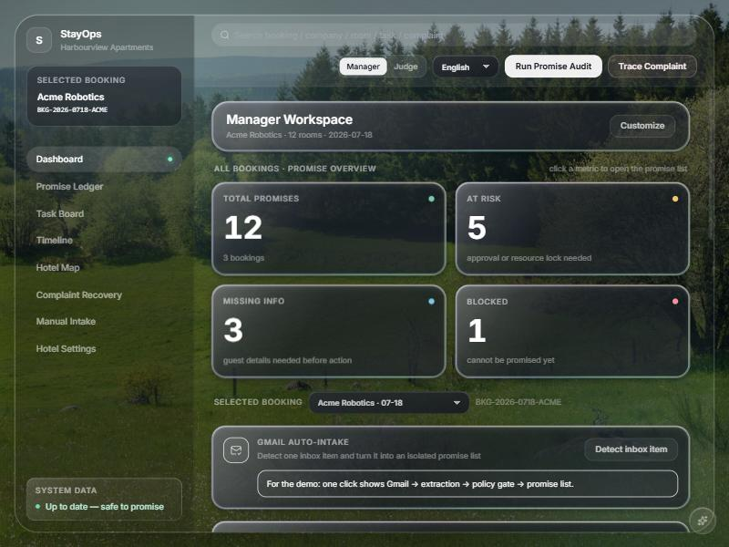

# StayOps Promise Ledger

**A promise verification and recovery layer for hotel operations — powered by a Gemini agent with deterministic policy guardrails.**

🔗 **[Live demo →](https://stayops-mzcsrz357a-uc.a.run.app)** · Built with Gemini + Google Cloud · Next.js 16 · Arize Phoenix observability

[](https://stayops-mzcsrz357a-uc.a.run.app)

StayOps is **not a guest chatbot and not a task manager**. It is a promise verification and recovery layer. A Gemini agent reads guest-facing promises *before* arrival, autonomously gathers operational evidence with tools, and a deterministic policy layer decides what the hotel can actually commit to — routing only verified or approved actions to teams. When something goes wrong, it traces a complaint back to the exact broken promise and the task that failed.

> **Design principle: Gemini proposes, deterministic policy decides.** The LLM extracts promises and gathers evidence; rules make the final, auditable call. An LLM can never upgrade a promise to a guarantee the data does not support.

## Problem

Hotels do not only fail because they reply slowly. They fail because promises made in sales emails, guest messages, and internal notes never reach the right operational team — or reach it as a task with the wrong due time. StayOps inserts a verification step: *don't blindly convert requests into tasks; first verify whether the hotel should make or fulfill the promise; create tasks only for verified or approved promises; and if a complaint happens, trace exactly where the promise chain broke.*

## How It Works — Agent Architecture

```
Corporate booking email + reservation
      │
      ▼
┌─────────────────────────────────────────────────────────────┐
│ A. Info Analysis                                              │
│    src/lib/infoAnalysis.ts                                    │
│    • Determines intake scope and basic-info completeness      │
│    • Extracts extra items with source message quotes          │
│    • Assigns domain, subtype, rule_key, and verification route│
└─────────────────────────────────────────────────────────────┘
      │
      ▼
┌─────────────────────────────────────────────────────────────┐
│ B. Agent Orchestration + Verification                         │
│    ADK service when ADK_AGENT_URL is configured; otherwise     │
│    the in-app Gemini ReAct loop; rules fallback if unavailable │
│    • Gemini proposes evidence-backed verification results      │
│    • Read-only tools gather freshness, SOP, inventory, rooms,  │
│      event-space, billing, and transport evidence              │
└─────────────────────────────────────────────────────────────┘
      │  (proposals + evidence)
      ▼
┌─────────────────────────────────────────────────────────────┐
│ C. Deterministic Policy Guardrails                           │
│    src/lib/agent/policy.ts                                   │
│    • Freshness gate: a stale required source can NEVER be     │
│      verifiable — forced down to cannot_confirm               │
│    • Missing-field rule: no required guest info ⇒ missing_info │
│    • SOP due-time rule: e.g. projector setup must be due      │
│      meeting_start − lead_time, not at meeting start          │
│    • Aligns extracted promises to stable ledger ids           │
└─────────────────────────────────────────────────────────────┘
      │
      ▼
   Promise Ledger + Task Plan — each row shows status, evidence,
   owner, source quote, and proposed follow-up/handoff action
      │
      ▼
   Manager approve / edit / reject  →  department tasks
      │
      ▼
   Complaint  →  trace_broken_promise  →  recovery plan + postmortem

   ⚠ If Gemini fails (quota / network / bad output) the audit
     falls back to the SAME deterministic policy — the demo never breaks.
```

The orchestration paths (ADK, Gemini loop, and offline fallback) share one policy engine, so they can never disagree on the final executable status. Whether ADK/Gemini actually ran is surfaced via `reasoning_source: "adk" | "gemini" | "rules"`.

## Demo Case

A boutique hotel receives a corporate offsite booking email from **Acme Robotics** (`BKG-2026-0718-ACME`, 12 rooms, `2026-07-18`→`2026-07-20`, meeting room `MR-BLUE` 14:00–17:00) with six guest-facing promises:

| Promise | Status | Why |
| --- | --- | --- |
| Early check-in | `cannot_confirm` | Group readiness uncertain; cannot guarantee. |
| Quiet king room for VP | `at_risk` | Limited quiet-zone king inventory; needs manager approval + room lock. |
| Gluten-free breakfast | `verifiable` | F&B can execute if notified by D-1 17:00. |
| Meeting room projector | `verifiable` | Equipment exists; setup task must be due 2h before meeting. |
| Airport transfer | `missing_info` | Flight number / arrival time missing. |
| Company invoice | `missing_info` | Billing contact / tax ID / address missing. |

A complaint later arrives — *"The VP was promised a quiet king room, but was placed near the elevator, and the projector was not ready when the meeting started."* — and StayOps traces it to **P-002** (front-desk room-blocking task `TASK-103` never completed) and **P-004** (`TASK-102` projector setup due at 14:00 instead of 12:00).

## Tech Stack

- **Next.js 16** (App Router) + **React 18** + **TypeScript**
- **Tailwind CSS**
- **Gemini 3.5 Flash on Vertex AI** via the `@google/genai` SDK, authenticated with **Application Default Credentials (ADC)** — no API key is stored (org policy requires ADC)
- **Google Cloud Agent Builder / ADK path** via the standalone `agent/promise_agent` service when `ADK_AGENT_URL` is configured
- **Deterministic policy engine** (rule guardrails) — the safety layer and offline fallback
- **Local CSV as a mock PMS** data layer, behind tool interfaces that an Opera/Cloudbeds/Mews adapter or a data warehouse pipeline can replace without touching agent logic
- **Arize Phoenix observability** via OpenTelemetry/OpenInference spans plus Phoenix MCP self-review, so the demo can show how Gemini reasoning, tool calls, and policy guardrails are audited

## Setup

### 1. Authenticate (ADC — no API key)

```bash
gcloud auth application-default login
gcloud config set project <YOUR_PROJECT_ID>
gcloud services enable aiplatform.googleapis.com
```

### 2. Configure

```bash
cp .env.example .env.local      # then set GOOGLE_CLOUD_PROJECT to your project id
```

`.env.local` holds no secrets — identity comes from ADC. It is gitignored.

### 3. Run

```bash
npm install
npm run dev        # http://localhost:3000
```

> **No Gemini access?** The app still works: every audit falls back to the deterministic policy engine and the UI badge shows `Deterministic policy`. Gemini is an enhancement, not a hard dependency.

### 4. Deploy (Cloud Run)

Canonical deployment target:

```text
GCP project: <your-gcp-project-id>
Region: us-central1
Cloud Run web URL: https://stayops-mzcsrz357a-uc.a.run.app
```

```bash
GCP_PROJECT=<your-gcp-project-id> ./scripts/deploy-cloud-run.sh
```

The script deploys both services from source with Cloud Build, points the ADK service's
tool callbacks at the app URL, and sets `ADK_AGENT_URL` on the app. `--max-instances 1`
keeps the demo's in-process state consistent.

Other scripts:

```bash
npm run typecheck   # tsc --noEmit
npm run lint        # tsc --noEmit (Next 16 removed `next lint`; ESLint config is a future add)
npm run build       # production build
npm run eval        # score the agent against evals/goldens.json (dev server must be running)
```

## Evaluating the Agent

How do you know the agent is actually good? Score it against a golden set instead of eyeballing it.

```bash
npm run dev          # in one terminal
npm run eval         # in another
```

`scripts/eval.mjs` enumerates every booking in `evals/goldens.json`, runs a real
audit for each one, and scores the result against the domain-authored golden
expectations:

```
Classification accuracy      6/6 (100%)
Approval compliance          6/6 (100%)
Unsafe overpromise count     0
Missing-info recall          2/2 (100%)
Human-control coverage       2/2 (100%)
Evidence coverage            6/6 (100%)
Tool-call coverage           6/6 (100%)
Overall                      PASS
```

To add a new scenario, add one booking entry to `evals/goldens.json` (expected
status, required tools, approval, `forbid_verifiable`, evidence keywords). The
domain expert defines "correct"; the script picks the case up automatically.

## Tool Contracts

Read-only evidence tools the agent may call (`src/lib/tools.ts`, exposed to Gemini in `src/lib/agent/agentTools.ts`). Write actions (`create_ops_task`) are **not** exposed to the model — task creation happens only after a manager approves.

| Tool | Purpose |
| --- | --- |
| `check_data_freshness(source)` | Freshness gate vs `sync_status.csv` at fixed `DEMO_NOW`. |
| `get_reservation(booking_id)` | Reservation record. |
| `search_messages(booking_id)` | All messages on the booking. |
| `check_room_readiness(type, constraints, arrival)` | Room suitability vs quiet/elevator constraints + readiness. |
| `check_inventory(item_type)` | Equipment availability. |
| `retrieve_sop(promise_type)` | Matching SOP rules. |
| `check_event_space(req, date_time, space_id)` | Equipment + `recommended_task_due_at`. |

## Data Model

All synthetic data lives in `/data` as CSV (loaded by `src/lib/data.ts`), acting as a mock PMS. Runtime task/approval mutations live in an in-memory overlay so the demo is repeatable.

## Status & Roadmap

**Done**
- Info Analysis layer for intake scope, basic info, extra items, source quotes, domains, rule keys, and verification routes
- Output-only Task Planning Agent (`task_plan`) for manager review, follow-up, cautious reply, or department handoff
- Gemini 3.5 Flash agent: real ReAct function-calling loop (`reasoning_source: gemini` verified)
- ADK / Agent Builder service as primary orchestration when `ADK_AGENT_URL` is configured, returning both proposals and its real tool-call trace
- Deterministic policy guardrails + freshness gate + automatic fallback
- **Agent-vs-safety-gate visibility**: every ledger row and the detail drawer show the status the agent proposed next to the status policy decided — and flag when the gate overruled the model
- **Phoenix MCP self-review of the latest audit trace**: the agent queries its own spans over the Arize Phoenix MCP server (Gemini turns, tool calls, injection-screen result) and shows them on the dashboard
- Eval harness with golden set and safety (overpromise) metric
- Bilingual operational UI: ledger, task board, timeline, hotel map, complaint recovery
- Cloud Run deploy script for both services: `./scripts/deploy-cloud-run.sh`

**Planned**
- Per-promise deep links into the matching Phoenix span
- More real front-desk scenarios (VIP upgrade, room move, maintenance, lost & found, long-stay pricing) with approval tiers
- A visible self-learning loop: manager approve/edit/reject → learned preferences/skills
- Real PMS adapter (Opera/Cloudbeds/Mews) behind the existing tool interfaces

## Limitations

- Single demo booking; the policy layer aligns promises to stable ids `P-001…P-006`.
- Gemini 3.x **Pro** is not enabled on the free-tier project; the agent uses **Gemini 3.5 Flash** (a Gemini 3 thinking model). Swap via `GEMINI_MODEL` when Pro access is granted.
- Free-tier Gemini quota is low; the agent uses exponential backoff and caches successful audits.
- Data freshness uses a fixed `DEMO_NOW`; the freshness gate logic is real, but all demo sources are currently fresh.
- Arize/Phoenix tracing and MCP self-review are present, but MCP evidence is not yet shown per promise and does not yet change policy decisions.
- Local ADK / Agent Builder orchestration is implemented and the app is deployed to Cloud Run (link above). The hosted environment needs `ADK_AGENT_URL` and the Phoenix env vars configured for the full ADK + tracing path.

## Project Docs

- [Product & technical spec](docs/00-spec.md)
- [Demo case](docs/01-demo-case.md) · [Agent design](docs/02-agent-design.md) · [API & tools](docs/03-api-and-tools.md)
- [Hotel domain background](docs/04-domain-background.md) · [Arize/Phoenix MCP](docs/05-mcp-arize.md) · [Personas & permissions](docs/06-personas-and-permissions.md)

## License

MIT. See [LICENSE](LICENSE).
